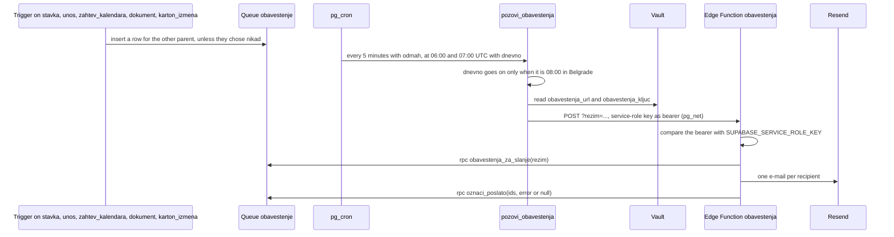

# Notification e-mail

How a change becomes an e-mail to the other parent (from `supabase/migrations/20261111010000_obavestenja.sql`,
`20261111020000_obavestenja_raspored.sql` and `supabase/functions/obavestenja/index.ts`).

